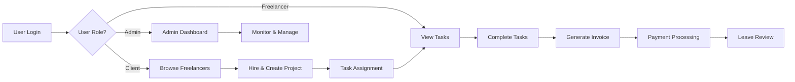
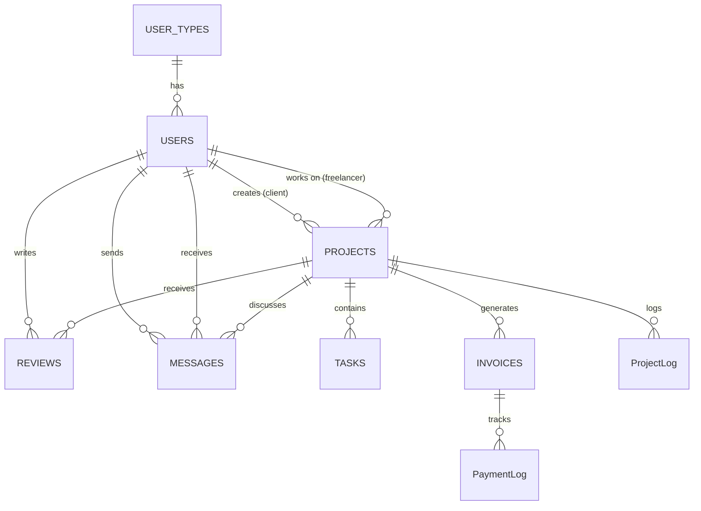

<div align="center">

# HireKoro

### Desktop Freelance Marketplace Platform


[](LICENSE)
[](https://www.microsoft.com/windows)
[](https://github.com/yourusername/HireKoro)


**A comprehensive desktop application that connects clients with skilled freelancers**

[Features](#-key-features) • [Installation](#-installation--setup) • [Database](#-database-schema) • [SQL Queries](#-sql-queries-reference) • [User Stories](#-user-stories) • [Future Roadmap](#-future-enhancement-possibilities)

### 🎯 Why HireKoro?

```
💼 Complete Freelance Ecosystem    🔐 Secure & Reliable         📊 Full Transparency
✅ Task Management Built-in        💰 Automated Invoicing       💬 Real-time Communication
📈 Performance Tracking            🛡️ Admin Controls            ⭐ Review System
```

---

</div>

## 📋 Overview

HireKoro is a comprehensive project management system designed for the freelance economy. It provides dedicated interfaces for three user types—clients, freelancers, and administrators—each with tailored workflows and features. The platform handles everything from freelancer discovery and project creation to task tracking, invoicing, and real-time messaging.

### 📊 Quick Stats

| Metric | Count |
|--------|-------|
| 🎨 **UI Forms** | 35+ custom forms and user controls |
| 🗄️ **Database Tables** | 9 core tables with relationships |
| 📝 **SQL Queries** | 52+ optimized queries |
| 👥 **User Roles** | 3 distinct role types (Client, Freelancer, Admin) |
| ✨ **Features** | 60+ planned enhancements |
| 🔐 **Security** | BCrypt password hashing |

### 🎯 Core Capabilities

<div align="center">

| 🧑‍💼 **For Clients** | 💻 **For Freelancers** | 🛡️ **For Admins** |
|:---:|:---:|:---:|
| Browse & hire freelancers | Manage tasks & projects | Monitor entire platform |
| Create & manage projects | Track earnings | User management |
| Real-time messaging | Build reputation | Audit logs & reports |
| Invoice processing | Portfolio showcase | Dispute resolution |

</div>

## ✨ Key Features

### 👥 User Management
- Role-based authentication system with secure password hashing using BCrypt
- Three distinct user types: Client, Freelancer, and Admin
- Profile management with custom fields for freelancers (skills, hourly rates, descriptions)
- Password reset functionality for account recovery

### 📊 Project Lifecycle
- Complete project workflow from posting to completion
- Project status tracking (Ongoing, Completed, etc.)
- Hourly-based cost calculation
- Project logs for tracking status changes and updates
- Comprehensive project details including descriptions, timelines, and deliverables

### ✅ Task Management
- Task assignment and tracking within projects
- Priority levels (High, Medium, Low)
- Status tracking (In Progress, Completed)
- Deadline management
- Task categorization by project

### 💰 Financial Operations
- Automated invoice generation based on project completion
- Invoice status tracking (Pending, Paid)
- Payment processing with logging
- Detailed payment history and audit trails
- Cost calculations based on hourly rates and project hours

### 💬 Communication
- Built-in messaging system for client-freelancer communication
- Real-time message threads organized by conversation
- Message history and timestamps
- Context-aware messaging within project scope

### ⭐ Reviews & Ratings
- 5-star rating system
- Written reviews and feedback
- Review management and moderation
- Historical review tracking per freelancer

### 🔧 Administrative Controls
- Full CRUD operations for all entities
- User management across all account types
- Project oversight and intervention
- System-wide logs for projects and payments
- Analytics dashboard for platform monitoring

### 📋 Feature Availability Matrix

| Feature | 🧑‍💼 Client | 💻 Freelancer | 🛡️ Admin |
|---------|:----------:|:-------------:|:--------:|
| Browse Freelancers | ✅ | ❌ | ✅ |
| Create Projects | ✅ | ❌ | ✅ |
| Manage Tasks | ❌ | ✅ | ✅ |
| View My Projects | ✅ | ✅ | ✅ |
| Messaging | ✅ | ✅ | ✅ |
| Invoices | ✅ | ✅ | ✅ |
| Payment Processing | ✅ | ❌ | ✅ |
| Leave Reviews | ✅ | ❌ | ✅ |
| Profile Management | ✅ | ✅ | ✅ |
| User Management | ❌ | ❌ | ✅ |
| System Logs | ❌ | ❌ | ✅ |
| Platform Analytics | ❌ | ❌ | ✅ |

## 📸 Screenshots

<div align="center">

> 🚧 **Screenshots coming soon**
>
> This section will showcase the main features including:
> - Login & Registration screens
> - Client dashboard with freelancer browsing
> - Freelancer task management interface
> - Admin control panel
> - Messaging system
> - Invoice and payment processing

</div>

## 🔄 System Workflow



## 📖 User Stories

### 🧑‍💼 Client Journey

**Discovery & Hiring**
1. Client logs in and browses available freelancers on the home page
2. Search and filter freelancers by name, skills, or hourly rate
3. View detailed freelancer profiles including skills, experience, and reviews
4. Select a freelancer and initiate the hiring process
5. Create a new project by defining scope, hours, and budget
6. System automatically calculates project cost based on freelancer's hourly rate

**Project Management**
1. Access all posted projects from the "My Projects" dashboard
2. View real-time project status and progress updates
3. Monitor assigned tasks and their completion status
4. Communicate with hired freelancers through the messaging system
5. Receive project updates and notifications

**Completion & Payment**
1. Review completed work and project deliverables
2. Receive automated invoice upon project completion
3. Process payment through the integrated payment system
4. Leave ratings and reviews for completed projects
5. View payment history and invoice records

### 💻 Freelancer Journey

**Onboarding**
1. Register with detailed profile (skills, hourly rate, description)
2. Build professional profile showcasing expertise
3. Set competitive hourly rates based on skill level

**Work Management**
1. Log in to view assigned tasks on the Task Dashboard
2. See tasks categorized by status (Ongoing vs Completed)
3. Access task details including deadlines and priority levels
4. Track all active projects from the "My Projects" section
5. Update task status as work progresses

**Client Interaction**
1. Communicate with clients through the messaging system
2. Discuss project requirements and clarifications
3. Update clients on task progress
4. Coordinate deadlines and deliverables

**Financial Tracking**
1. Monitor expected earnings through project dashboard
2. View generated invoices for completed work
3. Track payment status (Pending, Paid)
4. Access complete payment history
5. Build reputation through client reviews

### 🛡️ Administrator Journey

**Platform Oversight**
1. Access comprehensive admin dashboard upon login
2. Monitor all platform activities and metrics
3. View system-wide statistics and trends

**User Management**
1. View all registered users (clients, freelancers, admins)
2. Search and filter users by various criteria
3. Create, update, or deactivate user accounts
4. Modify user details and permissions
5. Handle user-related issues and disputes

**Project Administration**
1. Access all projects across the platform
2. Monitor project status and progress
3. Intervene in project disputes or issues
4. Update project information when necessary
5. View project logs for audit trails

**Task Oversight**
1. View all tasks across all projects
2. Search tasks by ID, name, or status
3. Manage task assignments and deadlines
4. Update task details and priorities
5. Track task completion rates

**Financial Administration**
1. Monitor all invoices and payment transactions
2. Manage invoice statuses
3. Review payment logs for auditing
4. Handle payment disputes or issues
5. Generate financial reports

**Quality Control**
1. Review and moderate user reviews
2. Monitor review ratings and feedback
3. Edit or remove inappropriate reviews
4. Ensure platform quality standards

**Audit & Compliance**
1. Access detailed project logs for all activities
2. Review payment logs for transaction history
3. Track system changes and modifications
4. Maintain platform integrity and compliance

## 🛠️ Tech Stack

| Category | Technology |
|----------|-----------|
| **Framework** | .NET Framework 4.8 |
| **UI Library** | Guna.UI2 WinForms (v2.0.4.7) |
| **Language** | C# (Windows Forms Application) |
| **Database** | Microsoft SQL Server (SQL Server Express) |
| **Security** | BCrypt.Net-Next (v4.0.3) for password hashing |
| **Architecture** | ADO.NET for data access with custom DataAccess layer |

## 🗄️ Database Schema

The application uses 9 core tables:

1. **USER_TYPES** - Defines user roles (Client, Freelancer, Admin)
2. **USERS** - Stores all user accounts and profile information
3. **PROJECTS** - Manages project details and assignments
4. **TASKS** - Tracks individual tasks within projects
5. **INVOICES** - Handles billing and payment records
6. **REVIEWS** - Stores ratings and feedback
7. **MESSAGES** - Manages communication between users
8. **ProjectLog** - Audit trail for project changes
9. **PaymentLog** - Audit trail for payment transactions

<div align="center">



</div>

## 📝 SQL Queries Reference

The application implements the following SQL operations across 8 major categories:

| Category | Queries | Description |
|----------|---------|-------------|
| 🔐 **Authentication & User Management** | 7 queries | User registration, login, password management |
| 📊 **Project Operations** | 9 queries | CRUD operations for projects |
| ✅ **Task Management** | 8 queries | Task tracking and status updates |
| 💰 **Invoice & Payment** | 7 queries | Billing and payment processing |
| ⭐ **Reviews** | 5 queries | Rating and feedback system |
| 💬 **Messaging System** | 3 queries | Real-time communication |
| 🛡️ **Admin Operations** | 9 queries | Platform administration |
| 📋 **Audit Logs** | 4 queries | Activity tracking and compliance |

<details>
<summary><b>Click to view all SQL queries</b></summary>

### 🔐 Authentication & User Management

**User Registration (Client)**
```sql
INSERT INTO USERS (Name, Username, Email, PasswordHash, UserTypeID)
VALUES ('{name}', '{username}', '{email}', '{hashPassword}', 1)
```

**User Registration (Freelancer)**
```sql
INSERT INTO USERS (Name, Username, Email, PasswordHash, UserTypeID, Skills, Description, HourlyRate, ProfileImg)
VALUES ('{name}', '{username}', '{email}', '{hashPassword}', 2, '{skills}', '{description}', {HourlyRate}, 'dummyUrl')
```

**User Login**
```sql
SELECT UserID, PasswordHash, UserTypeID, Name FROM USERS WHERE Email='{email}'
```

**Password Reset**
```sql
UPDATE USERS SET PasswordHash='{newHashedPassword}' WHERE UserID={userId}
```

**Check Duplicate User**
```sql
SELECT COUNT(*) FROM USERS WHERE Email='{email}' OR Username='{username}'
```

### Project Operations

**Fetch All Projects**
```sql
SELECT P.ProjectID, P.Title, P.ProjectStatus, P.ProjectHours, P.StartDate, P.Cost, P.ProjectDescription, C.Name AS ClientName, F.Name AS FreelancerName
FROM PROJECTS P
JOIN USERS C ON P.ClientID = C.UserID
LEFT JOIN USERS F ON P.FreelancerID = F.UserID
```

**Search Projects**
```sql
SELECT * FROM PROJECTS
WHERE ProjectID LIKE '{searchText}%' OR Title LIKE '{searchText}%'
```

**Create New Project (Hiring)**
```sql
INSERT INTO PROJECTS (ClientID, FreelancerID, Title, ProjectDescription, StartDate, ProjectHours, ProjectStatus, Cost)
OUTPUT inserted.ProjectID
VALUES ({clientId}, {freelancerId}, '{title}', '{description}', '{startDate}', {hours}, 'Ongoing', {cost})
```

**Get Projects by User**
```sql
-- For Freelancers
SELECT * FROM PROJECTS WHERE FreelancerId={userId}

-- For Clients
SELECT * FROM PROJECTS WHERE ClientId={userId}
```

**Update Project**
```sql
UPDATE PROJECTS SET
ClientName = '{clientName}',
FreelancerName = '{freelancerName}',
Title = '{title}',
ProjectDescription = '{description}',
ProjectStatus = '{status}',
ProjectHours = {hours},
StartDate = '{startDate}',
Cost = {cost}
WHERE ProjectID = '{projectId}'
```

**Delete Project**
```sql
DELETE FROM PROJECTS WHERE ProjectID = {projectId}
```

**Get Single Project**
```sql
SELECT * FROM Projects WHERE ProjectID = {projectId}
```

### Task Management

**Get All Tasks**
```sql
SELECT T.TaskID, T.NAME, T.Description, T.Status, T.Deadline, T.Priority, T.IsCompleted, P.Title
FROM TASKS AS T, PROJECTS P
WHERE T.ProjectID = P.ProjectID
```

**Get Freelancer Tasks (Completed)**
```sql
SELECT T.TaskID, T.Name AS TaskName, T.Status, T.Deadline, T.Description AS TaskDescription, P.ProjectID
FROM Tasks T
JOIN Projects P ON T.ProjectID = P.ProjectID
WHERE P.FreelancerID = {freelancerId} AND T.Status = 'Completed'
ORDER BY P.Title
```

**Get Freelancer Tasks (Ongoing)**
```sql
SELECT T.TaskID, T.Name AS TaskName, T.Status, T.Deadline, T.Description AS TaskDescription, P.ProjectID
FROM Tasks T
JOIN Projects P ON T.ProjectID = P.ProjectID
WHERE P.FreelancerID = {freelancerId} AND T.Status = 'In Progress'
ORDER BY P.Title
```

**Search Tasks**
```sql
SELECT T.TaskID, T.NAME, T.Description, T.Status, T.Deadline, T.Priority, T.IsCompleted, P.Title
FROM TASKS AS T, PROJECTS P
WHERE T.ProjectID = P.ProjectID AND (TaskID LIKE '{searchText}%' OR Name LIKE '{searchText}%')
```

**Create Task**
```sql
INSERT INTO Tasks (ProjectID, Name, Status, Description, Deadline, Priority)
VALUES ('{projectId}', '{name}', '{status}', '{description}', '{deadline}', '{priority}')
```

**Update Task**
```sql
UPDATE Tasks SET
ProjectID = '{projectId}',
Name = '{name}',
Status = '{status}',
Description = '{description}',
Deadline = '{deadline}',
Priority = '{priority}'
WHERE TaskID = '{taskId}'
```

**Delete Task**
```sql
DELETE FROM TASKS WHERE TaskID = {taskId}
```

### Invoice & Payment

**Get Client Invoices**
```sql
SELECT i.InvoiceID, p.Title AS ProjectName, i.Status AS CurrentStatus, i.IssueDate, i.DueDate, i.Amount
FROM INVOICES i
JOIN PROJECTS p ON i.ProjectID = p.ProjectID
WHERE p.ClientID = {userId}
```

**Get Freelancer Invoices**
```sql
SELECT i.InvoiceID, p.Title AS ProjectName, i.Status AS CurrentStatus, i.IssueDate, i.DueDate, i.Amount
FROM INVOICES i
JOIN PROJECTS p ON i.ProjectID = p.ProjectID
WHERE p.FreelancerID = {userId}
```

**Create Invoice**
```sql
INSERT INTO INVOICES (ProjectID, IssueDate, DueDate, Amount, Status)
VALUES ('{projectId}', '{issueDate}', '{dueDate}', {amount}, '{status}')
```

**Update Invoice**
```sql
UPDATE INVOICES SET
ProjectID = '{projectId}',
Status = '{status}',
Amount = {amount},
IssueDate = '{issueDate}',
DueDate = '{dueDate}'
WHERE InvoiceID = '{invoiceId}'
```

**Delete Invoice**
```sql
DELETE FROM INVOICES WHERE InvoiceID = {invoiceId}
```

### Reviews

**Get All Reviews**
```sql
SELECT R.ReviewID, U.Name, P.Title, R.Rating, R.Comment
FROM REVIEWS AS R, PROJECTS AS P, Users as U
WHERE R.ProjectID = P.ProjectID AND R.ReviewerID = U.UserID
```

**Get Freelancer Reviews**
```sql
SELECT R.ReviewID, R.Comment, U.Name AS ReviewerName, U.ProfileImg
FROM Reviews R
JOIN Projects P ON R.ProjectID = P.ProjectID
JOIN Users U ON R.ReviewerID = U.UserID
WHERE P.FreelancerID = {freelancerId}
ORDER BY R.ReviewID DESC
```

**Create Review**
```sql
INSERT INTO Reviews (ProjectID, ReviewerID, Rating, Comment)
VALUES ({projectId}, {reviewerId}, {rating}, '{comment}')
```

**Update Review**
```sql
UPDATE Reviews SET
ProjectID = '{projectId}',
ReviewerID = '{reviewerId}',
Rating = {rating},
Comment = '{comment}'
WHERE ReviewID = '{reviewId}'
```

**Delete Review**
```sql
DELETE FROM REVIEWS WHERE ReviewID = {reviewId}
```

### Messaging System

**Get Conversation List**
```sql
SELECT M.MessageID, M.ReceiverID, RU.Name, M.Content, M.SendAt
FROM MESSAGES AS M
JOIN USERS AS RU ON RU.UserID = M.ReceiverID
JOIN USERS AS SU ON SU.UserID = M.SenderID
WHERE M.SenderID = '{senderId}'
AND M.SendAt = (
    SELECT MAX(M2.SendAt)
    FROM MESSAGES AS M2
    WHERE M2.SenderID = M.SenderID AND M2.ReceiverID = M.ReceiverID
)
ORDER BY M.SendAt DESC
```

**Get Chat Messages**
```sql
SELECT M.SenderID, SU.Name, M.ReceiverID, RU.Name, M.Content, M.SendAt
FROM MESSAGES AS M, USERS AS SU, USERS as RU
WHERE Su.UserID = M.SenderID AND Ru.UserID = M.ReceiverID
AND ((M.SenderID = {senderId} OR M.SenderID = {receiverId})
AND (M.ReceiverID = {senderId} OR M.ReceiverID = {receiverId}))
```

**Send Message**
```sql
INSERT INTO MESSAGES (SenderID, ReceiverID, Content, SendAt)
VALUES ({senderId}, {receiverId}, '{content}', GETDATE())
```

### Admin Operations

**Get All Users**
```sql
SELECT * FROM Users
```

**Search Users**
```sql
SELECT * FROM Users WHERE UserID LIKE '{searchText}%' OR Name LIKE '{searchText}%'
```

**Get User Types**
```sql
SELECT * FROM USER_TYPES
```

**Create User (Admin)**
```sql
INSERT INTO USERS (UserTypeID, Username, Email, PasswordHash, Name, ProfileImg, Description, HourlyRate, Skills, CreatedAt)
VALUES ('{typeId}', '{username}', '{email}', '{password}', '{name}', '{profileImg}', '{description}', '{hourlyRate}', '{skills}', '{createdAt}')
```

**Update User (Admin)**
```sql
UPDATE USERS SET
UserTypeID = '{typeId}',
Username = '{username}',
Email = '{email}',
PasswordHash = '{password}',
Name = '{name}',
ProfileImg = '{profileImg}',
Description = '{description}',
HourlyRate = '{hourlyRate}',
skills = '{skills}'
WHERE UserID = '{userId}'
```

**Delete User**
```sql
DELETE FROM USERS WHERE UserID = {userId}
```

**Get Freelancers**
```sql
SELECT * FROM USERS WHERE UserTypeID = 2
```

**Search Freelancers**
```sql
SELECT * FROM Users WHERE UserTypeID = '2' AND (UserID LIKE '{searchText}%' OR Name LIKE '{searchText}%')
```

### Audit Logs

**Get Project Logs**
```sql
SELECT * FROM ProjectLog
```

**Create Project Log**
```sql
INSERT INTO PROJECTLOG (ProjectID, Status, Comment)
VALUES ('{projectId}', '{status}', '{comment}')
```

**Get Payment Logs**
```sql
SELECT * FROM PaymentLog
```

**Create Payment Log**
```sql
INSERT INTO PaymentLog (InvoiceID, Status, Comment)
VALUES ('{invoiceId}', '{status}', '{comment}')
```

</details>

> **💡 Pro Tip**: All queries use parameterized inputs with SQL injection prevention through input sanitization

## 🚀 Installation & Setup

### ⚡ Quick Start

```bash
# 1. Clone the repository
git clone https://github.com/yourusername/HireKoro.git

# 2. Open in Visual Studio
cd HireKoro
start HireKoro.sln

# 3. Update database connection string in DataAccess.cs

# 4. Run database scripts from DB/ folder

# 5. Build and run (F5)
```

### Prerequisites


- Windows OS (Windows 10 or later recommended)
- .NET Framework 4.8 or higher
- SQL Server Express (or SQL Server)
- Visual Studio 2019 or later (for development)

### Database Setup

1. Install SQL Server Express or SQL Server
2. Update the connection string in [DataAccess.cs](HireKoro/Utilities/DataAccess.cs#L45):
   ```csharp
   Data Source=YOUR_SERVER\SQLEXPRESS;Initial Catalog=HireKoroDB;Integrated Security=True;
   ```
3. Execute the database schema:
   - Run [Table_Create.sql](DB/Table_Create.sql) to create tables
   - Run [Value_Insert.sql](DB/Value_Insert.sql) to populate initial data

### Installation Steps

1. Clone the repository:
   ```bash
   git clone https://github.com/yourusername/HireKoro.git
   cd HireKoro
   ```

2. Restore NuGet packages:
   ```bash
   nuget restore HireKoro.sln
   ```

3. Set up the database (see Database Setup section above)

4. Build the solution:
   ```bash
   msbuild HireKoro.sln /p:Configuration=Release
   ```

5. Run the application:
   ```bash
   .\HireKoro\bin\Release\HireKoro.exe
   ```

## 📁 Project Structure

```
HireKoro/
├── HireKoro/                    # Main application folder
│   ├── Forms/                   # All UI forms and user controls
│   │   ├── Admin*.cs           # Admin dashboard components
│   │   ├── Client*.cs          # Client interface components
│   │   ├── Freelancer*.cs      # Freelancer interface components
│   │   ├── *Card.cs            # Reusable card components
│   │   └── ...
│   ├── Utilities/              # Core utilities
│   │   ├── Auth.cs            # Authentication logic
│   │   ├── DataAccess.cs      # Database operations
│   │   ├── PasswordHelper.cs  # Password hashing utilities
│   │   └── DraggableWindow.cs # UI helper
│   ├── Main.cs                # Main application window
│   └── Program.cs             # Application entry point
├── DB/                        # Database scripts
│   ├── Table_Create.sql      # Schema creation
│   └── Value_Insert.sql      # Sample data
└── packages/                 # NuGet packages
```

## ❓ FAQ & Troubleshooting

<details>
<summary><b>Common Issues and Solutions</b></summary>

### Database Connection Issues
**Problem**: Cannot connect to SQL Server
**Solution**:
- Verify SQL Server is running
- Check connection string in `DataAccess.cs`
- Ensure Windows Authentication is enabled
- Try using SQL Server Authentication instead

### Build Errors
**Problem**: Missing references or NuGet packages
**Solution**:
```bash
nuget restore HireKoro.sln
```

### Login Issues
**Problem**: Cannot login with test credentials
**Solution**:
- Ensure `Value_Insert.sql` has been executed
- Check if USERS table has data
- Verify password hashing is working correctly

### UI Not Loading
**Problem**: Forms not displaying correctly
**Solution**:
- Ensure Guna.UI2 package is installed
- Check .NET Framework version (4.8 required)
- Rebuild the solution

</details>

## 🔮 Future Enhancement Possibilities

<details>
<summary><b>Click to expand full roadmap (60+ features planned)</b></summary>

### Core Feature Expansions

**Advanced Search & Discovery**
- AI-powered freelancer recommendations based on project requirements
- Skills-based matching algorithms
- Portfolio showcase and work samples
- Verified badges and certifications
- Advanced filtering (location, availability, budget range)

**Enhanced Communication**
- Real-time chat with WebSocket integration
- File sharing and attachment support
- Video calling integration
- Group messaging for team projects
- Push notifications for messages

**Payment Integrations**
- PayPal, Stripe, or local payment gateway integration
- Escrow payment system for project security
- Milestone-based payments
- Automatic invoice generation with PDF export
- Tax calculation and reporting
- Multi-currency support

### Project Management Enhancements

**Advanced Task Management**
- Gantt charts for project timelines
- Kanban board view
- Subtasks and task dependencies
- Time tracking integration
- Automated deadline reminders
- Task templates for recurring work

**Collaboration Tools**
- Shared workspace for files and resources
- Version control for deliverables
- Comment threads on tasks and projects
- Activity feeds and notifications
- Project milestones and checkpoints

### Platform Features

**Analytics & Reporting**
- Earnings dashboard for freelancers
- Project performance metrics
- Time-to-completion analytics
- Success rate tracking
- Custom report generation
- Data export capabilities (CSV, PDF)

**Quality & Trust**
- Identity verification system
- Skill assessments and tests
- Background checks integration
- Dispute resolution mechanism
- Freelancer ranking system
- Client reputation scores

### Technical Improvements

**Architecture & Performance**
- Migration to .NET 6/7/8 for cross-platform support
- Web-based version (ASP.NET Core + React/Vue)
- Mobile applications (iOS/Android)
- RESTful API for third-party integrations
- Microservices architecture for scalability
- Redis caching for performance optimization

**Security Enhancements**
- Two-factor authentication (2FA)
- OAuth integration (Google, Microsoft, GitHub)
- Session management improvements
- IP-based access controls
- Comprehensive audit logging
- GDPR compliance features

**Database Optimization**
- Stored procedures for complex queries
- Database indexing strategy
- Query performance optimization
- Database sharding for scalability
- Automated backup systems

### User Experience

**UI/UX Improvements**
- Modern, responsive design overhaul
- Dark mode support
- Customizable dashboards
- Accessibility features (WCAG compliance)
- Multi-language support (i18n)
- Progressive Web App (PWA) capabilities

**Smart Features**
- Email notifications for key events
- Calendar integration
- Contract templates
- Automated status updates
- Smart reminders and follow-ups
- AI chatbot for support

### Business Features

**Marketplace Enhancements**
- Freelancer subscription tiers
- Featured listings and promotions
- Platform commission configuration
- Referral program
- Loyalty rewards system
- Team accounts for agencies

**Advanced Workflows**
- Proposal system for project bidding
- Contract management
- NDA and legal document signing
- Time-off and availability calendar
- Recurring projects support
- Bulk operations for admins

### Integration Possibilities

- GitHub/GitLab integration for dev projects
- Google Calendar/Outlook sync
- Slack/Discord notifications
- Zapier/IFTTT automation
- Cloud storage (Dropbox, Google Drive)
- CRM system integration
- Accounting software sync (QuickBooks, Xero)

### Compliance & Legal

- GDPR data protection features
- Terms of service acceptance tracking
- Privacy policy management
- Right to deletion implementation
- Data portability features
- Compliance reporting tools

</details>

## 🤝 Contributing

This project was developed as a university project. Contributions, issues, and feature requests are welcome for educational purposes.

### How to Contribute

1. Fork the repository
2. Create a feature branch (`git checkout -b feature/AmazingFeature`)
3. Commit your changes (`git commit -m 'Add some AmazingFeature'`)
4. Push to the branch (`git push origin feature/AmazingFeature`)
5. Open a Pull Request

## 📞 Support & Contact

- 📧 **Email**: [your-email@university.edu](mailto:your-email@university.edu)
- 💬 **Issues**: [GitHub Issues](https://github.com/yourusername/HireKoro/issues)
- 📖 **Documentation**: Check the [Wiki](https://github.com/yourusername/HireKoro/wiki)
- 🌟 **Star the project** if you find it useful!

## 📜 License

This project is developed for educational purposes at the university level.

## 👨‍💻 Authors

Developed as part of a university database management and software engineering course.

---

<div align="center">

### ⚠️ Important Note

This application uses **Integrated Security** for SQL Server. Ensure your SQL Server instance is properly configured for Windows Authentication, or modify the connection string in [DataAccess.cs](HireKoro/Utilities/DataAccess.cs#L45) to use SQL Server authentication if needed.

---

**Made with ❤️ for educational purposes**

[](https://github.com/yourusername/HireKoro)
[](https://github.com/yourusername/HireKoro)

### 🙏 Acknowledgments

- Built with **Guna.UI2** for modern, professional UI components
- Secured with **BCrypt.Net** for password hashing
- Powered by **SQL Server** for robust data management
- Developed as part of university coursework in Database Management Systems

---

### 📊 Project Stats

```
Lines of Code: 10,000+        Files: 80+              Commits: 100+
UI Components: 35+            Database Tables: 9      SQL Queries: 52+
```

**HireKoro** - Connecting talent with opportunity, one project at a time.

</div>
